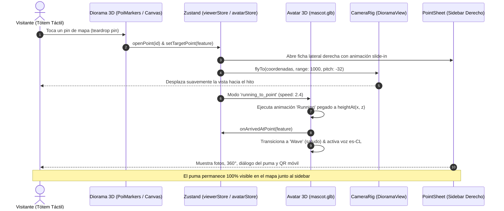

# Sistema de Avatar 3D, Marcadores (POI Pins) y Ficha Lateral (Sidebar)

> **Documento de Referencia Técnica y Guía de Evolución**  
> **Fecha de Actualización:** Octubre 2026  
> **Propósito:** Documentar la arquitectura, decisiones de diseño, interacción 3D y componentes visuales implementados para que futuros agentes y desarrolladores puedan continuar mejorando la experiencia del tótem interactivo BioMap.

---

## 1. Contexto y Objetivos de la Transformación

En la versión inicial del módulo del avatar y los puntos de interés se identificaron tres fricciones críticas para la experiencia en el tótem táctil de 55" 4K:

1. **Diseño de Puntos:** Los marcadores anteriores eran círculos planos pequeños que no se destacaban suficientemente sobre la textura satelital y el relieve 3D. Se rediseñaron a **pines de mapa tipo gota (_teardrop pin_)** de mayor tamaño (54 × 70 px) inspirados en señalética cartográfica moderna, con cuerpo en color de la capa, círculo interior blanco con icono semántico temático y sombra elíptica de apoyo.
2. **Velocidad del Avatar:** El desplazamiento del personaje entre puntos se sentía lento (`RUN_TO_POINT_SPEED = 0.55`). Se cuadruplicó la velocidad a `2.4`, permitiendo que el puma corra de forma ágil y enérgica hacia cualquier destino seleccionado en 1-2 segundos.
3. **Eliminación del Modal y Adopción del Sidebar:** Anteriormente, al llegar el personaje se abría un modal bloqueante centrado (`AvatarArrivalModal`) con fondo oscuro (`bg-black/60`). Esto rompía la inmersión porque tapaba toda la maqueta 3D y ocultaba al propio personaje. Se reemplazó por un **Sidebar acoplado a la derecha** (`PointSheet`), manteniendo al avatar visible y animado en el centro del escenario 3D mientras toda la información se despliega en el lateral.

---

## 2. Diagrama de Flujo e Interacción



---

## 3. Detalle de Archivos y Componentes Modificados

### 3.1. Marcadores de Puntos (`apps/web/src/diorama/PoiMarkers.jsx`)

- **Estructura SVG Teardrop:** Cada pin renderiza un SVG vectorial con forma de gota:
  ```xml
  <svg viewBox="0 0 54 70" width="54" height="70" className="poi-pin__svg">
    <path
      d="M 27 68 C 21 53 3 42 3 26 A 24 24 0 1 1 51 26 C 51 42 33 53 27 68 Z"
      fill={layer.color}
      stroke="#ffffff"
      strokeWidth="2.5"
    />
    <circle cx="27" cy="26" r="15" fill="#ffffff" />
  </svg>
  ```
- **Iconografía Semántica (`getPoiIcon`):** Se mapean iconos de `lucide-react` según palabras clave y slugs:
  - `Zap`: Centrales hidroeléctricas y presas.
  - `Trees`: Parques, senderos, bosques y ecología.
  - `Camera`: Miradores y vistas panorámicas.
  - `Waves`: Playas, ríos, lagos y balnearios.
  - `Landmark`: Historia y patrimonio.
  - `Binoculars` / `MapPin`: Puntos turísticos generales.
- **Badge de Visitado:** Si el usuario ya descubrió el hito, se renderiza una insignia verde con `Check` (`✓`) en la esquina superior del pin.
- **Parámetros de Oclusión y Decluttering:**
  - `DOT = 54` (ancho efectivo del pin).
  - `STEM = 16`.
  - `LABEL_GAP = 12`.
  - `PIN_HEIGHT = 0.008` (para que la punta toque la superficie del relieve).

### 3.2. Estilos del Pin (`apps/web/src/styles/map.css`)

- `.poi-pin`: Posicionado con `transform: translate(-27px, -68px)` para que el vértice inferior del SVG coincida exactamente con la coordenada 3D en el terreno.
- `.poi-pin__shadow`: Sombra radial elíptica en la punta (`rgba(0, 0, 0, 0.55)`).
- `.poi-pin__label`: Píldora de texto en alto contraste con tipografía nítida y fondo blanco translúcido (`rgba(255, 255, 255, 0.95)`).
- Animaciones suaves de hover y escala activa.

### 3.3. Personaje 3D (`apps/web/src/diorama/Avatar.jsx`)

- **Velocidades:**
  - `RUN_TO_POINT_SPEED = 2.4` (carrera hacia un hito seleccionado).
  - `PATROL_SPEED = 0.75` (patrulla autónoma entre puntos cuando nadie toca la pantalla).
- **Adherencia al Relieve:**
  - En cada cuadro del render loop (`useFrame`), se calcula `currentPos.current.y = heightAt(currentPos.current.x, currentPos.current.z)`. Esto previene que el avatar atraviese colinas o flote en el aire al correr a alta velocidad.
- **Transición de Animaciones:**
  - `Idle` -> `Running` / `Walking` -> `Wave` (saludo al llegar) -> `Idle`.

### 3.4. Ficha Lateral / Sidebar (`apps/web/src/features/point/PointSheet.jsx` y `cards.css`)

- **Ubicación Fija a la Derecha:**
  ```css
  .point-sheet {
    position: fixed;
    top: 24px;
    right: 24px;
    bottom: 24px;
    z-index: 50;
    width: min(440px, calc(100vw - 48px));
    height: calc(100vh - 48px);
    border-radius: 28px;
    box-shadow: -16px 0 48px rgba(0, 0, 0, 0.35);
  }
  ```
- **Contenido Incluido:**
  1. **Encabezado:** Chip con el color y nombre de la categoría, y botón de cierre táctil amplio (`64x56 px`).
  2. **Etapa Multimedia:** Galería de fotos deslizable y pestaña para **Panorama 360°** interactivo.
  3. **Título y Badge:** Nombre del lugar e indicador de "Visitado".
  4. **Burbuja de Diálogo del Puma:**
     - `🦊 Puma Guardián del Biobío: ¡Aquí estamos en [Nombre]! Observa el entorno y revisa los datos patrimoniales.`
  5. **Descripción y Créditos:** Texto cultural optimizado con soporte para aumento de fuente (`--text-scale`).
  6. **Código QR Móvil:** Generado localmente vía `qrcode` para que el visitante pueda abrir la ficha en su smartphone.
- **Adaptabilidad Responsive:** En pantallas de smartphone (`<= 760px`), la ficha se transforma automáticamente en un bottom sheet (`bottom: 8px; left: 8px; right: 8px; height: 70vh`).

### 3.5. Integración en la App Principal (`apps/web/src/App.jsx`)

- Se removió por completo la importación y renderizado de `AvatarArrivalModal`.
- Se configuró el atributo `data-sheet-open={openSheets.length > 0 ? 'true' : undefined}` en el elemento `<main>`.
- **Desplazamiento de Controles HUD:** En [hud.css](file:///c:/Users/Administrator/Desktop/Proyecto%20de%20Titulo/biomap/apps/web/src/styles/hud.css), cuando `data-sheet-open="true"`, la columna `.hud__right` (barra de accesibilidad, brújula y controles de zoom/inclinación) se desplaza suavemente a la izquierda:
  ```css
  @media (min-width: 1024px) {
    .hud__right {
      transition: transform 0.35s cubic-bezier(0.16, 1, 0.3, 1);
    }
    .viewer[data-sheet-open='true'] .hud__right {
      transform: translateX(-456px);
    }
  }
  ```
  Esto garantiza que los controles sigan 100% accesibles y visibles al lado del sidebar, sin taparse entre sí.

### 3.6. Narrador de Voz Offline (`apps/web/src/features/avatar/AvatarNarrator.jsx`)

- La síntesis de voz en español (`es-CL`) vía Web Speech API continúa activa narrando la bienvenida.
- El diálogo flotante en pantalla se oculta cuando `selectedPointIds.length > 0`, ya que el sidebar derecho contiene el texto y la burbuja del personaje, evitando redundancias visuales en el centro de la pantalla.

---

## 4. Pruebas y Validación del Sistema

| Suite de Pruebas            | Resultado                          | Descripción                                                                        |
| :-------------------------- | :--------------------------------- | :--------------------------------------------------------------------------------- |
| `npm test -w apps/web`      | **127 / 127 PASSED** (26 archivos) | Cobertura total de componentes, hooks, diorama 3D, matematicas de cámara y stores. |
| `npm test -w apps/api`      | **61 / 61 PASSED** (13 archivos)   | Cobertura total de endpoints REST, validaciones Zod y mocks de base de datos.      |
| `npm run build -w apps/web` | **ÉXITO (0 errores)**              | Bundle de producción compilado limpiamente con Vite y Three.js.                    |

---

## 5. Recomendaciones y Hoja de Ruta para el Próximo Agente

Si vas a continuar mejorando este sistema, ten en cuenta las siguientes oportunidades detectadas:

### 💡 Ideas de Mejora Recomendadas:

1. **Offset de Cámara al Abrir un Punto:**
   - Actualmente `flyTo` centra las coordenadas en `(0.5, 0.5)` del viewport. Dado que el sidebar ocupa los 440px de la derecha, se podría aplicar un ligero offset horizontal en `CameraRig.jsx` para que el punto quede perfectamente centrado en el área visible izquierda `(0.38 del ancho)`.
2. **Audio Pregrabado como Alternativa:**
   - Web Speech API depende de las voces del sistema operativo del Mini PC. Considerar un fallback a archivos `.mp3` o `.ogg` locales en `public/audio/` para cada hito si la voz TTS del sistema suena muy robótica o no está configurada.
3. **Efecto de Partículas al Llegar:**
   - Se puede agregar un sutil efecto de hojas otoñales o destellos dorados en Three.js (`pointsGeometry`) alrededor del puma durante los 2 primeros segundos de su llegada al hito.
4. **Pasaporte BioMap Digital:**
   - Aprovechar el `visitedPoints` de `useUserStore` para mostrar en el sidebar cuántos hitos de la ruta ha completado el visitante (ej. _"Has descubierto 4 de 12 lugares del Biobío"_).

### ⚠️ Reglas Obligatorias para Futuros Agentes:

- **NO USAR SUBAGENTES DE NAVEGADOR:** El usuario realiza pruebas visuales directamente en su entorno (`http://localhost:5173/`).
- **MANTENER ARQUITECTURA 100% OFFLINE:** No importar nada desde CDNs externas.
- **VERIFICAR TESTS:** Ejecutar siempre `npm test -w apps/web` tras cualquier cambio funcional.
